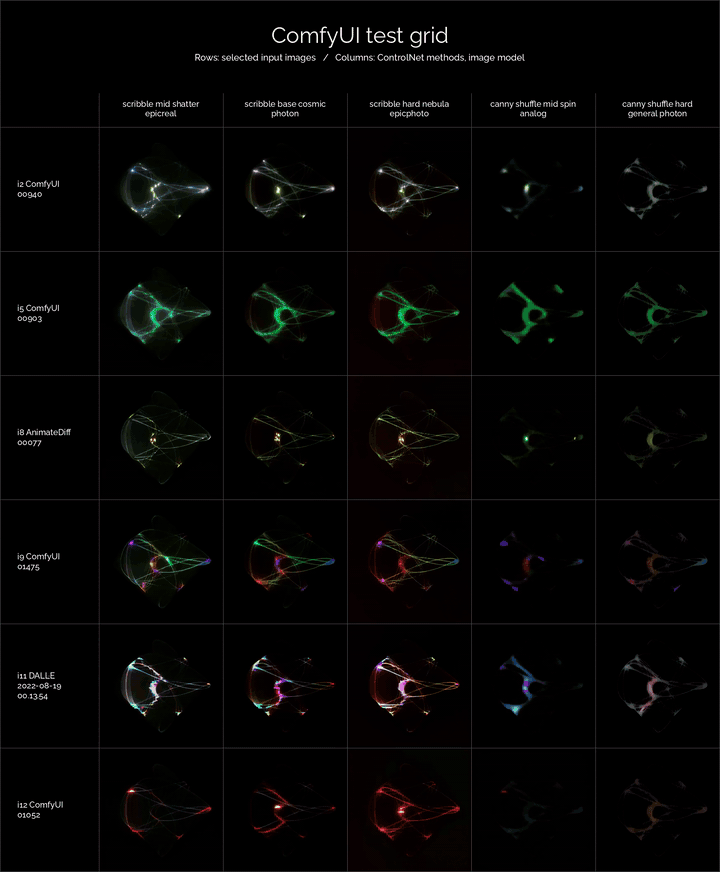

# comfyui-matrix-videos

Turn parameter sweeps **or an ordered selection of videos** into a labeled matrix video.

`comfyui-matrix-videos` is a small Python CLI for reviewing video/image-generation sweeps: rows and columns are batch parameters, and each cell plays the corresponding generated clip. It is designed to pair well with the Hermes Agent ComfyUI skill's `run_batch.py` output, but it also works as a standalone manifest-to-MP4 tool.

<p align="center">
  
</p>

## Choose a mode

| Mode | Input | Layout and timing |
|---|---|---|
| **Sweep** (existing default) | JSON/JSONL/CSV parameter records | Row/column axes, sampled/scaled clips, silent output |
| **Manual** (`manual`) | Ordered paths and optional labels + design JSON | Native equal-sized clips, explicit cadence, optional one-source audio, whole-grid loops |

Use manual mode for curated comparisons without inventing parameter axes:

```bash
python3 examples/create_manual_sample.py --directory ./sample-manual
comfy-matrix-video manual --sources sample-manual/sources.json \
  --design sample-manual/design.json --output-prefix outputs/selected
```

See [Manual mode](docs/manual-mode.md) for selection order, geometry, audio, preparation, caches, defaults and limits. `comfy-matrix-video manual --help` lists its options. Existing flag-only commands below remain sweep mode; an optional `sweep` prefix is also accepted. Manual design JSON and sweep style JSON are separate schemas.

## Features

- Reads JSON, JSONL, or CSV manifests.
- Works with Hermes ComfyUI batch results and simple custom manifests.
- Configurable row/column keys using dotted paths like `args.steps`, `params.profile`, or `outputs[].file`.
- Renders H.264 MP4 matrix videos with FFmpeg and Pillow.
- Uses a temp work directory outside the output directory by default.
- Optional first-frame PNG export for quick preview/contact-sheet use.
- No application-specific database, tagging, or metadata integration required.

## Requirements

- Python 3.10+
- FFmpeg on `PATH`; manual mode also uses ffprobe, libx264 and FFV1
- Python package dependency: Pillow

## Install

From a clone:

```bash
python3 -m venv .venv
. .venv/bin/activate
python -m pip install -e .
```

Or run without installing:

```bash
PYTHONPATH=src python3 -m comfyui_matrix_videos.cli --help
python3 scripts/comfy_matrix_video.py --help
```

If you use `uv`:

```bash
uv run --with-editable . comfy-matrix-video --help
```

## Quick start

### From Hermes ComfyUI `run_batch.py`

Hermes' ComfyUI batch script emits one JSON object with a `results` array. Each result contains `args` and downloaded `outputs`.

```bash
python3 /path/to/comfyui-skill/scripts/run_batch.py \
  --workflow workflow_api.json \
  --args '{"prompt":"abstract luminous shape"}' \
  --sweep '{"steps":[8,16],"seed":[101,202,303]}' \
  --output-dir ./outputs/sweep \
  > batch.json

comfy-matrix-video \
  --manifest batch.json \
  --row-key args.steps \
  --col-key args.seed \
  --video-key outputs[].file \
  --title "ComfyUI sweep" \
  --subtitle "Rows: steps   Columns: seed" \
  --output ./outputs/steps_by_seed_matrix.mp4 \
  --preview-frame ./outputs/steps_by_seed_matrix.png
```

### From a JSONL manifest

For custom batch runners, one JSON object per line is convenient:

```jsonl
{"status":"success","params":{"phase":"motion","input_index":1,"profile":"low_motion"},"result":{"outputs":[{"fullpath":"outputs/a.mp4"}]}}
{"status":"success","params":{"phase":"motion","input_index":1,"profile":"high_motion"},"result":{"outputs":[{"fullpath":"outputs/b.mp4"}]}}
```

Render one phase:

```bash
comfy-matrix-video \
  --manifest batch.jsonl \
  --phase motion \
  --row-key params.input_index \
  --col-key params.profile \
  --video-key result.outputs[].fullpath \
  --output motion_matrix.mp4
```

## Useful options

```bash
comfy-matrix-video --help
comfy-matrix-video --manifest batch.json --row-key args.steps --col-key args.seed --dry-run
```

Important flags:

- `--row-key`, `--col-key` — dotted JSON/CSV paths used as matrix axes.
- `--row-label-key`, `--col-label-key` — optional separate label paths.
- `--video-key` — dotted path to a video path. Supports list expansion with `[]`, e.g. `outputs[].file`.
- `--phase` — shorthand for `--filter params.phase=<value>`.
- `--filter KEY=VALUE` — repeatable exact-match filters.
- `--style` — JSON style file. See `templates/matrix_style.example.json`.
- `--frames` — number of frames to sample from each source clip.
- `--preview-frame` — write frame 1 as a PNG beside the MP4.
- `--dry-run` — print inferred rows/columns and missing cells without invoking FFmpeg.

## Style

The default style is presentation-oriented: black background, white Raleway typography, subtle thin white grid lines, generous title/subtitle spacing, pixel-aware row-label wrapping, and a top legend band without a horizontal rule above the column labels.

Use `--style templates/matrix_style.example.json` to customize:

- canvas size, optional fixed cell size, and legend dimensions
- colors and grid-line alpha
- font family, explicit font paths, and variable-font weights
- title/subtitle/label sizes and positions
- row-label left/right padding
- top legend padding and separator positions
- FPS and CRF
- temp work root

Font handling is local-only. The style can specify `font_family` such as `Raleway`; the renderer asks the local system/fontconfig for that font and falls back to `font_fallback` if it is not installed. It never streams Google Fonts or fetches fonts at render time. For consistent output, install or vendor the font in your project and point `font_regular` / `title_font` at the local `.ttf` file.

Keep the temp work root outside directories that other apps are watching. Sweep mode creates many temporary PNG frames; manual mode streams video and keeps lossless preparation/composition caches.

## Manifest compatibility

The CLI can auto-detect common video path locations:

- `result.outputs[].fullpath`
- `outputs[].file`
- `outputs[].fullpath`
- `outputs[].path`
- `video`
- `file`

For predictable results, pass `--video-key` explicitly.

## Hermes skill

This repository includes a Hermes skill at:

```text
skills/creative/comfyui-matrix-videos/SKILL.md
```

To install it into a local Hermes setup from this clone:

```bash
mkdir -p ~/.hermes/skills/creative
cp -R skills/creative/comfyui-matrix-videos ~/.hermes/skills/creative/
```

The skill includes both the markdown instructions and supporting files:

```text
skills/creative/comfyui-matrix-videos/SKILL.md
skills/creative/comfyui-matrix-videos/scripts/comfy_matrix_video.py
skills/creative/comfyui-matrix-videos/templates/matrix_style.example.json
```

The copyable skill includes both modes: standalone scripts, manual sources/design templates, and `references/manual-mode.md` as well as the existing sweep style. No repository checkout is needed after copying it (Pillow and FFmpeg are still required). It explains mode selection and verification.

## Development

```bash
PYTHONPATH=src python3 -m unittest discover -s tests
PYTHONPATH=src python3 -m comfyui_matrix_videos.cli \
  --manifest examples/comfy_batch_manifest.jsonl \
  --row-key args.steps \
  --col-key args.seed \
  --video-key outputs[].file \
  --dry-run
```

To render the sample matrix locally:

```bash
python3 examples/create_sample_media.py
PYTHONPATH=src python3 -m comfyui_matrix_videos.cli \
  --manifest examples/comfy_batch_manifest.jsonl \
  --row-key args.steps \
  --col-key args.seed \
  --video-key outputs[].file \
  --output outputs/example_matrix.mp4 \
  --preview-frame outputs/example_matrix.png
```

Tests include tiny synthetic FFmpeg renders when FFmpeg/ffprobe are present; CI installs them. They cover sweep helpers, manual order/geometry/validation, stage/cache separation, lossless preparation, audio/silent output, exact grid repeats, overwrite protection and bundled-script parity. No original media or GPU is used.

After changing package code/templates/docs, refresh the standalone bundles and verify parity:

```bash
python3 scripts/sync_standalone.py
python3 scripts/sync_standalone.py --check
```

## License

MIT. See `LICENSE`.
